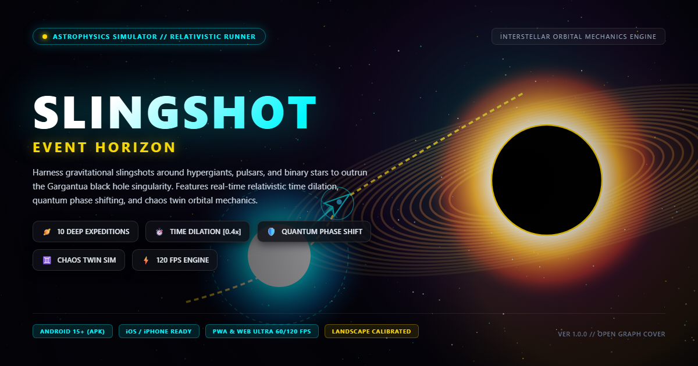
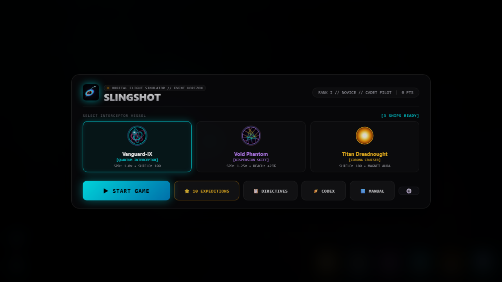
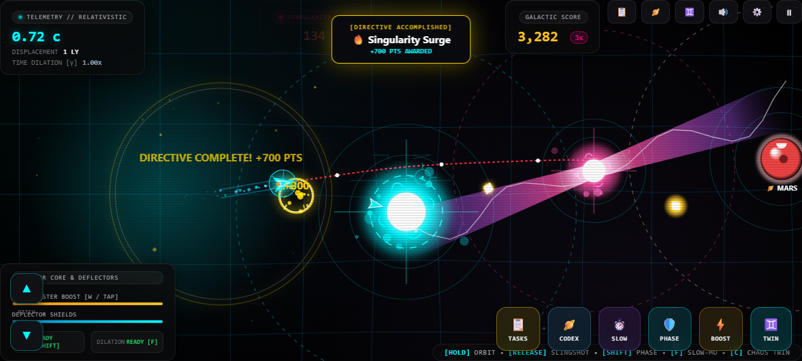

# 🌌 SLINGSHOT: EVENT HORIZON
> *A high-octane cosmic physics runner and orbital navigation simulator inspired by Interstellar.*

[]()
[]()
[-00e5ff.svg)]()
[-ff007f.svg)]()
[](LICENSE)
[]()

---



---

## 🚀 Overview

**Slingshot: Event Horizon** is a cinematic orbital physics flight simulator and survival runner. Players pilot an advanced deep-space interceptor caught in the gravitational wake of **Gargantua**, a collapsing supermassive black hole. 

With primary propulsion offline, your only method of survival is a **Gravitational Tether Hook**—latching onto celestial bodies, entering stable or elliptical orbits, and slingshotting through gravity wells at relativistic fractions of the speed of light ($0.80c+$).

Designed with a high-performance Canvas 2D engine, landscape-first cockpit HUD, generative Web Audio synthwave, and multi-platform native deployment (Web, Android APK, and iOS).

---

## 📸 In-Game Visuals & Previews

| Title Hangar & Interceptor Selector | In-Flight Cockpit HUD & Accretion Disk |
|:---:|:---:|
|  |  |

---

## ✨ Key Features

- **60 FPS Hardware-Accelerated Physics**: Custom sub-stepped numerical integration with additive screen blending, particle pooling, and spacetime fabric curvature rendering.
- **Landscape-First Cockpit Interface**: Calibrated exclusively for wide-angle landscape navigation with automated orientation blockers and holographic CRT scanline styling.
- **10-Level Interstellar Campaign**: Progressive expedition challenges ranging from Solar escape orbits and binary stars to neutron magnetars and Gargantua's point-of-no-return.
- **8 Dynamic Mission Directives**: In-flight goals including relativistic velocity ($0.80c$), triple perfect slingshots, planetary surface touchdowns, science probe deployments, and hyperspace wormhole jumps.
- **3 Playable Interceptor Vessels**: Unique flight characteristics, shield profiles, and special gravitational perks.
- **100% Code-Generated Synthwave Engine**: Zero external audio files—real-time multi-oscillator basslines, 808 beats, lead arpeggios, and Doppler-shifted orbital tether hums via Web Audio API.
- **Cross-Platform Native Builds**:
  - **Web**: Progressive Web App (PWA) with strict CSP, HSTS, and Open Graph previews.
  - **Android**: Native APK compiled with target SDK 36, hardware acceleration, and sensor landscape lock.
  - **iOS**: Xcode project with landscape-only orientations, strict Apple ATS, and mandatory privacy manifests.

---

## 🛸 Interceptor Fleet

Choose your vessel from the Hangar before initiating launch:

| Vessel | Class | Stats & Flight Dynamics | Special Perks |
|---|---|---|---|
| **Vanguard-IX** | Quantum Interceptor | `SPD: 1.0x` • `SHIELD: 100` | Balanced hull, standard quantum shields and responsive ion thrusters. |
| **Void Phantom** | Dispersion Skiff | `SPD: 1.25x` • `REACH: +25%` | Twin fuselage chassis, +25% top speed, and extended gravitational tether range. |
| **Titan Dreadnought** | Corona Cruiser | `SHIELD: 180` • `MAGNET: High` | Heavily armored hull, high shield resilience, and automatic graviton aura drawing in stardust. |

---

## 🎮 Flight Controls

Calibrated for keyboard, mouse, and tactile mobile touch controls:

| Action | Desktop / Keyboard | Mouse Controls | Touch / Mobile |
|---|---|---|---|
| **Engage Gravitational Tether** | `Spacebar` (Hold) | `Left Click` (Hold) | Tap & Hold Screen |
| **Slingshot Release** | `Spacebar` (Release) | `Left Click` (Release) | Lift Finger |
| **Ion Thrusters (Boost)** | `W` or `Up Arrow` | `Right Click` (Hold) | ⚡ **BOOST** Button |
| **Quantum Phase Shift** | `Shift` or `E` | — | 🛡️ **PHASE** Button |
| **Relativistic Time Dilation** | `F` or `Q` | — | ⏱️ Cockpit Control |
| **Pause Systems** | `P` or `Escape` | Pause Icon (HUD) | Pause Icon (HUD) |
| **Mute / Unmute Audio** | `M` | Speaker Icon (HUD) | Speaker Icon (HUD) |

---

## 🌌 Celestial Bodies & Hazards

| Celestial Object | Gravitational Signature | Tactical Advice |
|---|---|---|
| 🔵 **Blue Hypergiant** | Balanced gravity well, moderate orbit speed. | Ideal for initiating stable slingshot vectors. |
| 🔴 **Red Supergiant** | Vast gravitational radius, gentle pull. | Excellent for wide, high-speed sweeping maneuvers. |
| 🟣 **White Dwarf** | Compact radius with extreme G-force. | High-risk orbital insertion yielding colossal ejection velocities. |
| 💥 **Magnetar Pulsar** | Sweeping high-energy radiation beams. | Time your slingshot between beam sweeps or activate Phase Shift. |
| 🌌 **Binary Star System** | Dual stars orbiting a shared barycenter. | Weave between both gravity wells to trigger **Double Assist** bonuses. |
| 🌀 **Kerr Wormhole** | Rotating spacetime distortion ring. | Fly into the throat to warp $1,500\text{ Light-Years}$ across the sector. |
| 🪨 **Asteroid Belt** | Dense debris fields. | Use ion thrusters to adjust vector or Phase Shift through obstacles. |
| 🪐 **Terran & Ice Worlds** | Atmospheric planetary bodies. | Descend to orbital ceiling for touchdown surface exploration. |

---

## 🏗️ Architecture & Project Structure

```
slingshot-game/
├── android/                   # Native Android Capacitor Project (Target SDK 36)
│   ├── app/src/main/
│   │   ├── AndroidManifest.xml # Landscape orientation & strict network security
│   │   └── res/                # App icons, splash screens, and security XML
│   └── build.gradle
├── ios/                       # Native iOS Capacitor Project (Xcode / CocoaPods)
│   └── App/
│       ├── App/Info.plist      # Landscape-only, Apple ATS, encryption exemptions
│       ├── App/PrivacyInfo.xcprivacy # Apple iOS 17/18 privacy manifest
│       └── App.xcodeproj
├── public/                    # Production Static Assets & Social Cards
│   ├── og-image.png           # 1200x630 Open Graph cover banner
│   ├── thumbnail.png          # 800x450 Compact social thumbnail
│   ├── screenshot-landscape.png # 1280x720 Title hangar screenshot
│   ├── screenshot-gameplay.png  # 1280x720 In-flight cockpit gameplay shot
│   ├── manifest.json          # PWA Web App Manifest with wide screenshots
│   └── _headers               # Production HTTP security headers
├── src/                       # Modular Game Engine
│   ├── audio/engine.js        # Generative Web Audio multi-synth engine
│   ├── core/haptics.js        # Cross-platform mobile vibration & haptics
│   ├── game/
│   │   ├── game.js            # Core simulation loop & cockpit HUD manager
│   │   ├── entities.js        # Vessel, black hole, star, and hazard models
│   │   ├── levels.js          # 10-level progressive Interstellar campaign
│   │   ├── planets.js         # Procedural planet generation & surface terrain
│   │   └── tasks.js           # 8 mission directives & objective tracking
│   ├── physics/engine.js      # Relativistic physics & orbital trajectory predictor
│   ├── render/
│   │   ├── orbs.js            # Procedural 3D vessel hologram renderer
│   │   ├── particles.js       # Additive screen-blended particle engine (60 FPS)
│   │   ├── nebula.js          # Deep space parallax starfields & dust clouds
│   │   └── planet-sim.js      # Surface landing simulation view
│   ├── main.js                # Game lifecycle, UI controller, input handlers
│   └── style.css              # Cyberpunk HUD theme, scanlines & orientation locks
├── tests/                     # Automated Vitest test suite (13/13 passing)
│   ├── smoke.test.js
│   ├── campaign.test.js
│   ├── tasks.test.js
│   ├── chaos.test.js
│   └── planets.test.js
├── capacitor.config.json      # Capacitor cross-platform configuration
├── vercel.json                # Vercel deployment config with strict CSP & HSTS
├── vite.config.js             # Vite 5 production bundler configuration
└── slingshot-event-horizon.apk # Pre-built production Android APK (5.98 MB)
```

---

## 🛠️ Development & Local Setup

### Prerequisites
- **Node.js**: v18.0.0 or higher
- **npm** or **pnpm**

### Installation
```bash
# Clone the repository
git clone https://github.com/devcrazy2812/Slingshot-Game.git
cd Slingshot-Game

# Install dependencies
npm install

# Start local development server
npm run dev
```
Open **`http://localhost:5173/`** in your browser.

### Testing
Run the automated Vitest test suite:
```bash
npm run test
```

### Production Web Build
```bash
npm run build
npm run preview
```

---

## 📱 Mobile Builds (Android & iOS)

### 🤖 Android (APK Build)
The project includes a ready-to-install Android build:
- **Pre-built APK**: [`slingshot-event-horizon.apk`](slingshot-event-horizon.apk) (5.98 MB).
- **Compile manually**:
  ```bash
  npm run build
  npx cap sync android
  cd android
  ./gradlew assembleDebug
  ```
  The generated APK will be located at:
  `android/app/build/outputs/apk/debug/app-debug.apk`.

### 🍎 iOS (App Store & TestFlight)
1. Ensure Xcode is installed on a Mac (or build via cloud CI like GitHub Actions/Codemagic).
2. Sync the web assets:
   ```bash
   npm run build
   npx cap sync ios
   npx cap open ios
   ```
3. In Xcode:
   - Go to **Signing & Capabilities** and select your Apple Developer Team.
   - Set device target to **`Any iOS Device (arm64)`**.
   - Select **Product ➔ Archive**.
   - In the Organizer window, click **Distribute App ➔ App Store Connect ➔ Upload**.

---

## 🚀 Vercel Deployment

The project is pre-configured for instant zero-configuration deployment on **Vercel**:
- Automatic deployments on `git push` to `main` via GitHub integration.
- Includes [`vercel.json`](vercel.json) with production security headers:
  - Strict Content Security Policy (`CSP`)
  - Strict Transport Security (`HSTS` max-age 2 years)
  - `X-Frame-Options: DENY`
  - `X-Content-Type-Options: nosniff`
  - `Referrer-Policy: strict-origin-when-cross-origin`
  - Immutably cached static asset headers for optimal performance.

---

## 📄 License

Distributed under the **MIT License**. See [`LICENSE`](LICENSE) for more information.
