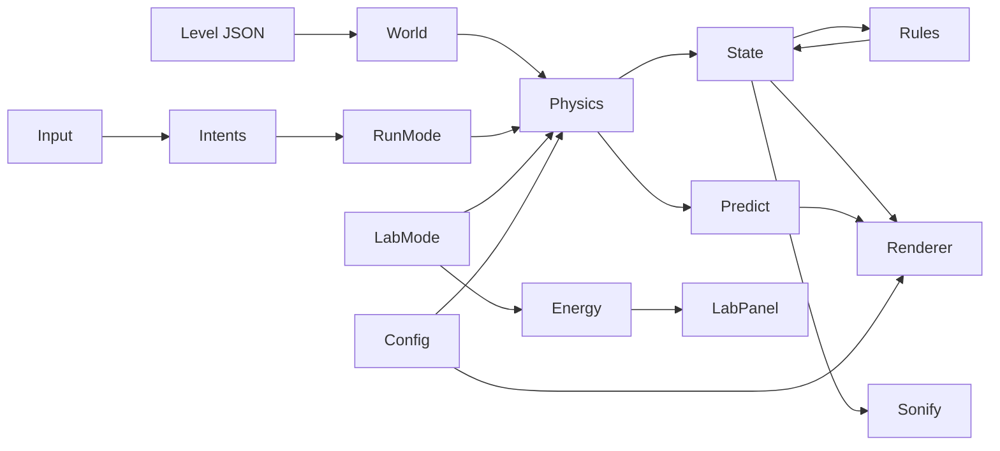

# Architecture: Slingshot: Event Horizon

## 1. Principles
1. **Physics is pure.** No DOM, randomness or clocks inside `src/physics/`. Easy to test, easy to trust.
2. **One source of truth.** The game and the prediction line call the same `stepShip`.
3. **Data in, pixels out.** Levels are JSON. Rendering never changes game state.
4. **Zero runtime dependencies.** Smaller attack surface, nothing to break on stage.
5. **Fail soft.** Bad numbers reset to a safe state instead of crashing.

## 2. Stack and why
| Choice | Reason |
|---|---|
| Vite (dev dependency) | Fast dev server and a one-command static build. |
| Vanilla JS, ES modules | No framework to learn; the agent writes it reliably. |
| Canvas 2D | Enough for this game, simple, fast, runs on phones. |
| Web Audio API | Synthesised sound, so no audio files and no licence risk. |
| Vitest (dev dependency) | Runs the physics tests quickly. |
| Static hosting | GitHub Pages or Netlify; no server to attack or pay for. |

## 3. Folder structure
```
slingshot/
├── index.html
├── package.json            (pinned versions, scripts)
├── vite.config.js
├── public/                 (favicon only)
├── src/
│   ├── main.js             (boot, scene manager, loop start)
│   ├── config.js           (ALL tunable numbers and feature flags)
│   ├── core/
│   │   ├── loop.js         (fixed timestep + accumulator)
│   │   ├── events.js       (tiny pub/sub bus)
│   │   ├── rng.js          (seeded RNG: mulberry32, hash of strings)
│   │   └── storage.js      (safe localStorage wrapper, validates on read)
│   ├── physics/            (PURE; no DOM)
│   │   ├── vec.js
│   │   ├── bodies.js       (static + rail bodies, position/velocity at time t)
│   │   ├── gravity.js      (acceleration at a point and time)
│   │   ├── integrator.js   (stepShip: leapfrog + tether + dilation)
│   │   ├── predict.js      (runs stepShip forward on a copy)
│   │   ├── energy.js       (energy, frame transform, fuel saved)
│   │   └── chaos.js        (twin ship, divergence, Lyapunov estimate)
│   ├── game/
│   │   ├── state.js        (the single game-state object and reset)
│   │   ├── level.js        (load + validate level JSON, build world)
│   │   ├── rules.js        (win, lose, scoring, black hole chaser)
│   │   ├── input.js        (keyboard, mouse, touch to intents)
│   │   └── modes/          (run.js, lab.js, mission.js)
│   ├── render/
│   │   ├── renderer.js     (draw order, camera, interpolation)
│   │   ├── fabric.js       (warped spacetime grid)
│   │   ├── sprites.js      (pre-rendered glow sprites)
│   │   ├── particles.js    (pooled typed arrays)
│   │   ├── hud.js          (text via textContent, canvas HUD)
│   │   └── lens.js         (optional WebGL lensing, 2D fallback)
│   ├── audio/
│   │   ├── engine.js       (AudioContext, master gain cap, unlock on gesture)
│   │   └── sonify.js       (speed to pitch, proximity to bass, events to sfx)
│   ├── ui/
│   │   ├── menu.js         (menu, settings, safety toggles)
│   │   ├── lab-panel.js    (sliders, charts, Reality Check)
│   │   └── cards.js        (mission fact cards)
│   └── data/
│       ├── levels/*.json
│       └── missions/*.json
├── tests/                  (physics.test.js, rng.test.js, level.test.js ...)
└── docs/
```

## 4. Module map


## 5. Game loop
Fixed timestep with accumulator and render interpolation.
```js
const DT = 1 / 120;
let acc = 0, last = performance.now();
function frame(now) {
  acc += Math.min((now - last) / 1000, 0.1); // clamp to avoid spiral of death
  last = now;
  while (acc >= DT) { update(DT); acc -= DT; }
  render(acc / DT); // alpha for interpolation
  requestAnimationFrame(frame);
}
```
- Pause the loop when the tab is hidden (`visibilitychange`).
- `update` runs: intents, physics, rules, audio parameters, particles.

## 6. State model
```js
/** @typedef {{x:number,y:number}} Vec */
state = {
  mode: 'menu' | 'run' | 'lab' | 'mission',
  phase: 'ready' | 'playing' | 'won' | 'lost',
  t: 0,                 // galaxy time (seconds)
  tau: 0,               // ship proper time (seconds)
  ship: { pos, vel, tetherTo: null | bodyId, tetherLen: 0 },
  twin: null | { pos, vel },          // Chaos Twin
  world: { bodies: [...], blackHole: {...}, exit: {...}, seed },
  score: { distance, speedGain, fuelSavedKg },
  settings: { reducedMotion, flash, shake, volume, sonification },
}
```

## 7. Physics API (signatures the agent must implement)
```js
// vec.js
export const add, sub, scale, dot, len, norm;

// bodies.js
/** Position of a body at galaxy time t. Rail bodies use analytic orbits. */
export function bodyPos(body, t) {}
export function bodyVel(body, t) {}

// gravity.js
/** Acceleration on the ship at position p and time t, from all bodies. */
export function accelAt(p, t, bodies, cfg) {}

// integrator.js
/** Advance a ship by one galaxy-time step. Pure: returns a new ship object. */
export function stepShip(ship, t, dt, world, cfg) {}

// predict.js
/** Simulate forward `steps` using stepShip. Stops on collision. */
export function predictPath(ship, t, world, cfg, steps) {}

// energy.js
export function specificEnergy(ship, t, world, frameBodyId = null) {}
export function fuelSavedKg(deltaV, cfg) {}
```

## 8. Rendering pipeline (draw order)
1. Background gradient and parallax star layers (pre-rendered to offscreen canvas).
2. Spacetime fabric grid (warped by masses at the current time).
3. Orbit guides for rail bodies (faint).
4. Bodies (glow sprites, not `shadowBlur` per frame).
5. Black hole (accretion ring, event-horizon disc, optional lensing).
6. Prediction line (dotted, fading).
7. Ship, tether, trails, Echo Ghost, Chaos Twin.
8. Particles.
9. HUD and Lab overlays.

Camera follows the ship horizontally with smoothing; zoom eases out as speed rises. Draw only what is on screen.

## 9. Performance budget
| Item | Budget |
|---|---|
| Frame time | Under 16 ms typical, never over 25 ms |
| Bodies | Max 24 (config clamp) |
| Prediction | 900 steps per frame, each step cheap; skip when no target |
| Particles | 800 pooled, no per-frame allocation |
| Fabric grid | About 48 by 27 points, one `Path2D` stroke per row and column |
| Allocation | No `new` objects inside the hot loop where avoidable; reuse arrays |

## 10. Input model
Raw events become **intents** (`aim`, `tetherPress`, `tetherRelease`, `pause`, `restart`, `flipFrame`). Modes read intents only. This keeps keyboard, mouse and touch identical.
- Mouse: click and hold to tether to the nearest body in range; release to let go.
- Keyboard: Space hold and release; arrow keys or A and D change target; R restart; P pause; F frame flip in Lab.
- Touch: press and hold anywhere; nearest body in range is chosen.

## 11. Levels as data
```json
{
  "id": "binary-gate",
  "seed": "a1b2c3",
  "length": 12000,
  "ship": { "x": 0, "y": 360, "vx": 120, "vy": 0 },
  "exit": { "x": 11800, "y": 360, "radius": 80 },
  "bodies": [
    { "id": "s1", "kind": "star", "mu": 4000000, "radius": 22, "x": 900, "y": 300 },
    { "id": "p1", "kind": "pulsar", "mu": 3000000, "radius": 14,
      "rail": { "cx": 2400, "cy": 360, "R": 140, "phase": 0, "dir": 1, "partner": "p2" } },
    { "id": "p2", "kind": "pulsar", "mu": 3000000, "radius": 14,
      "rail": { "cx": 2400, "cy": 360, "R": 140, "phase": 3.14159, "dir": 1, "partner": "p1" } }
  ],
  "blackHole": { "x0": -900, "v0": 40, "accel": 3, "mu": 6000000, "r0": 60, "growth": 1.5 }
}
```
`level.js` validates: required fields, numeric ranges, max body count, unique ids, no unknown keys, and rejects `__proto__`, `constructor` and `prototype` keys.

## 12. Persistence
`storage.js` wraps `localStorage` in try/catch (it can throw or be disabled). Keys are namespaced `slingshot:v1:*`. Every read is parsed and validated; invalid data is discarded. Stored: settings, best scores, best-run ghost (size capped).

## 13. Audio
`AudioContext` is created only after the first user gesture. One master `GainNode` capped at 0.3. Sources: a smooth oscillator for speed pitch, filtered noise for whoosh, a low sine for black hole rumble, short envelopes for tether and snap. No audio files.

## 14. Error handling
- Global `window.onerror` shows a calm "Signal lost, press R" overlay (using `textContent`).
- Physics NaN guard restores the last safe state.
- Storage and audio failures degrade silently to "off".

## 15. Build and deploy
- `npm run build` outputs `dist/`.
- Netlify: add `public/_headers` with the CSP from security.md.
- GitHub Pages: CSP via `<meta http-equiv>` in `index.html` (header-only directives are not available there).
- Keep a recorded demo video and a local `dist/` copy for offline backup.

## 16. Architecture decisions (summary)
| # | Decision | Why |
|---|---|---|
| A1 | Bodies on analytic rails | Exact, cheap prediction; deterministic replays and tests |
| A2 | Ship is a test particle | Keeps maths simple and stable |
| A3 | Leapfrog, not Euler | Far better energy behaviour for orbits |
| A4 | Softened gravity | Prevents infinite acceleration at close range |
| A5 | Canvas 2D, not Three.js | Smaller, faster to build, fewer dependencies |
| A6 | Seeded RNG | Daily Galaxy, reproducible bugs, shareable runs |
| A7 | No backend | Nothing to hack, host or pay for |
